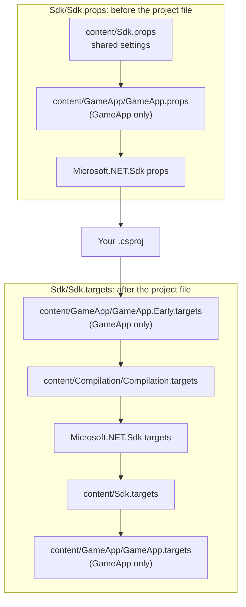

# Contributing

Thanks for helping. This page explains how the repository is laid out, how the SDKs work, and how to test and release a change.

Bugs and ideas go in [issues](https://github.com/bottlenoselabs/sdk/issues). For anything bigger than a small fix, open an issue first so we can agree on the approach.

## Layout

```text
.github/
  workflows/cs-build.yml, cs-game-publish.yml   Reusable workflows, for other repositories
  actions/cs-release/                           The release action, for other repositories
  workflows/main.yml, release.yml               This repository's own CI, which uses the reusable workflows and the action
ext/
  SDL/                   SDL's C source, a Git submodule pinned to an SDL release
  build-sdl.sh           Builds the native SDL library into lib/<runtime identifier>/
src/cs/
  production/
    Sdk/                 Shared settings for every SDK, and the bottlenoselabs.Sdk package
      Sdk.props          Imported before the project file
      Sdk.targets        Imported after Microsoft.NET.Sdk's targets
      CodeAnalysis/      Analyzers and code style rules
      Compilation/       NativeAOT for Release
      GameApp/           Game settings and platform packaging (used by Sdk.GameApp only)
      NuGet/             Package defaults
      Sdk/               The entry points MSBuild imports for bottlenoselabs.Sdk
    Sdk.WebApp/Sdk/      The entry points for bottlenoselabs.Sdk.WebApp
    Sdk.GameApp/Sdk/     The entry points for bottlenoselabs.Sdk.GameApp
    SdkPackage.targets   How the three SDK packages are packed
    SDL.Native/          bottlenoselabs.SDL.Native: the native SDL library for every platform
    Templates/           bottlenoselabs.Templates: the bl-game, bl-webapp and bl-lib templates
  tests/Consumers/       Test projects that use the packed SDKs, and test.sh
docs/                    Documentation
```

## How the SDKs work

Each package is an [MSBuild project SDK](https://learn.microsoft.com/visualstudio/msbuild/how-to-use-project-sdk). When a project says `<Project Sdk="bottlenoselabs.Sdk.GameApp">`, MSBuild finds the package version in `global.json`, downloads it from NuGet, and imports its `Sdk/Sdk.props` before the project file and its `Sdk/Sdk.targets` after it.

Our entry points wrap a Microsoft SDK and add our files around it:



Where a setting goes depends on what it needs:

| Put it in | When the setting | Example |
| --- | --- | --- |
| `*.props` | Is a plain default the project can override | `Nullable`, `InvariantGlobalization` |
| `Compilation.targets`, `GameApp.Early.targets` | Depends on the project file (`OutputType`, `Configuration`), and Microsoft's targets must see it | `PublishAot` for executables in Release |
| `Sdk.targets`, `GameApp.targets` | Needs everything Microsoft's targets computed, or adds targets and items | Copying assets, packaging after publish |

In the early targets, only set a property when it's empty (`Condition=" '$(PublishAot)' == '' "`), so the project's own value still wins.

Every package carries a copy of the whole `Sdk/` folder as `content/`, so a project only needs the one package it uses. This repository's own projects use `Microsoft.NET.Sdk` and import the shared files directly through `src/cs/Directory.Build.props`.

The SDKs must never put Bottlenose Labs' name on other people's projects: no company, authors, copyright, package ID prefix, icon or file header by default. This repository sets its own identity in `src/cs/Directory.Build.props` and `.editorconfig`, the same way any other organization would. The tests fail if that identity leaks into a consumer project or into a repository created from a template.

## Testing

```bash
./src/cs/tests/Consumers/test.sh
```

The script:

1. packs all the packages into `nupkg/`;
2. builds one consumer project per SDK against them, in Debug and Release. A target in `tests/Consumers/Directory.Build.targets` fails the build when a property isn't what the SDK promises;
3. publishes the console and game consumers with NativeAOT, checks the macOS `.app` or Linux `.AppDir`, and runs them. The game reads a file from its assets folder;
4. creates a repository from each template in a temporary folder, builds it in Debug and Release, and publishes and runs the game.

When you add or change a setting, add a check for it to `Directory.Build.targets`.

CI runs the script on Windows, Linux and macOS for every pull request, publishes the game consumer with `cs-game-publish.yml`, and runs the Linux AppImage it produces.

To lint workflows, use [actionlint](https://github.com/rhysd/actionlint).

## SDL

SDL's C source is in the `ext/SDL` submodule, pinned to an SDL release. You only need it to build the native library; clone it with:

```bash
git submodule update --init --depth 1 ext/SDL
```

Build the native library for your computer with `ext/build-sdl.sh`. It writes `lib/<runtime identifier>/` (for example `lib/osx-arm64/libSDL3.dylib`), which `SDL.Native` packs as `runtimes/<runtime identifier>/native/`. Platforms you haven't built are left out of a local package. You need CMake and a C compiler; on Linux, also [SDL's development packages](https://wiki.libsdl.org/SDL3/README-linux).

In CI, `.github/workflows/sdl-native.yml` builds all six platforms. Each build is cached by the SDL commit and the build script, so SDL is only rebuilt when one of them changes.

To upgrade SDL, check out a newer release tag in the submodule and commit the change:

```bash
git -C ext/SDL fetch --depth 1 origin tag release-<version>
git -C ext/SDL checkout release-<version>
git add ext/SDL
```

## Releasing

Releases are published to NuGet.org by the **Release** workflow (`release.yml`), run by hand from the Actions tab on `main`. It uses NuGet trusted publishing; the policy on NuGet.org names `release.yml`. It packs the three SDKs and the templates with one version (by default today's date, for example `2026.11.27`), pushes them to NuGet.org, and creates a GitHub release with the tag `v<version>`. Other repositories pin the reusable workflows to that tag.
